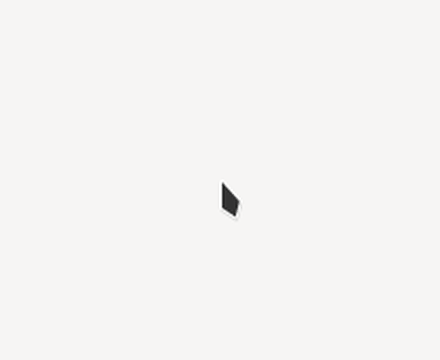
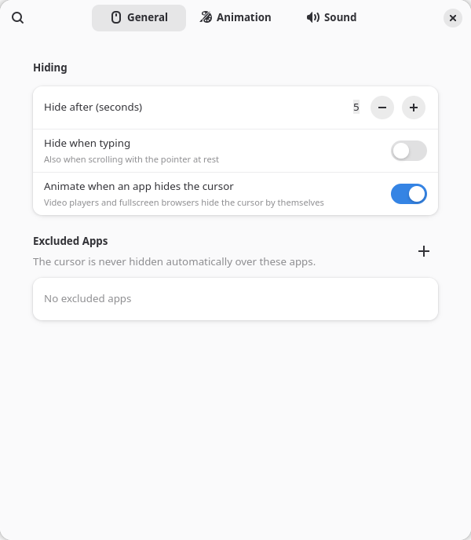
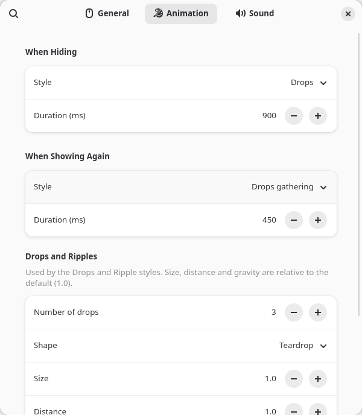
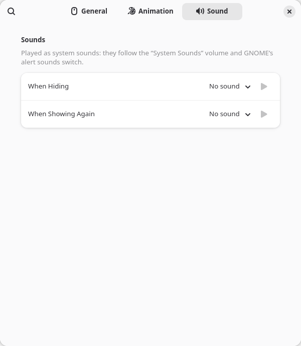

# Hide Cursor Drops

A GNOME Shell extension that hides the mouse cursor when you are not using
it, with an animation: the cursor shrinks into its center, three small balls
pop out of it and fly off as drops. When you move the mouse again, the drops
come back and merge into the cursor.



The drops take the color of your cursor. The extension reads the current
cursor image and uses its fill color for the drops and its outline color
for their border, so it matches any cursor theme and shape (arrow, text
beam, busy spinner, ...).

## Features

- Hides the cursor after a configurable idle time, or as soon as you type.
- Five animations for hiding (drops, shrink, fade, ripple or none) and five
  for showing again (drops gathering, grow, fade, ripple or none).
- Drops are customizable: number, shape (teardrop, ball or spark), size,
  distance, gravity and color.
- Works over fullscreen windows, and animates even when a video player or
  browser hides the cursor by itself.
- Optional sounds when hiding and showing: bundled drop sounds or your own
  files.
- Per-app exclusions: the cursor is never hidden over the apps you pick.

Requires GNOME Shell 49 or 50 on Wayland.

## Installation

### From source

```sh
git clone https://github.com/Wender13/hide-cursor-animated.git
cd hide-cursor-animated
make install
```

Building needs `glib-compile-schemas` and `msgfmt` (packages `glib2` and
`gettext`, already present on most GNOME systems).

### From a zip

```sh
make pack
gnome-extensions install --force hide-cursor-drops@wender13.github.io.shell-extension.zip
```

### Enabling it

GNOME on Wayland only discovers new extensions at login, so **log out and
back in** once after installing, then enable it in the *Extensions* app or
with:

```sh
gnome-extensions enable hide-cursor-drops@wender13.github.io
```

If you use another cursor-hiding extension, such as
[Hide Cursor](https://github.com/elcste/hide-cursor), disable it first; both
would fight over the cursor.

## Usage

Once enabled, there is nothing to do: stop moving the mouse for 5 seconds
and the cursor hides; move it and it comes back.

To change how it behaves, open the preferences from the *Extensions* app
(the gear next to the extension) or with:

```sh
gnome-extensions prefs hide-cursor-drops@wender13.github.io
```

### General



- **Hide after** – seconds without moving the mouse before the cursor hides
  (1–60, default 5).
- **Hide when typing** – hides the cursor as soon as you start typing,
  without waiting. GNOME doesn't let extensions see which keys you press,
  so any input that isn't mouse motion or a click counts: scrolling with
  the mouse at rest hides the cursor too. Off by default. Some apps (VS
  Code, GTK text fields) hide the cursor themselves while you type; that
  is the app, not the extension, and it only gets the animation when this
  option is on.
- **Animate when an app hides the cursor** – video players, fullscreen
  browsers make the cursor invisible by themselves, usually before the
  timeout. With this on, the animation plays when they do. Pointer grabs
  in games don't trigger it, and neither do apps hiding the cursor while
  you type, unless *Hide when typing* is on.
- **Excluded apps** – press **+** to pick apps from the list of installed
  ones. While the pointer is over one of their windows, the cursor is never
  hidden, neither by the timeout nor by typing.

### Animation



- **When hiding** – the style and its duration:
  - *Drops*: the cursor shrinks into its center and balls fly out of it,
    stretching into drops, in one continuous motion.
  - *Shrink*: the cursor swells briefly and shrinks into its center.
  - *Fade*: the cursor fades out.
  - *Ripple*: the cursor collapses into two expanding rings.
  - *None*: the cursor just disappears.
- **When showing again** – the style and its duration: *Drops gathering*
  (the drops fly back and merge into the cursor), *Grow*, *Fade*, *Ripple*
  (a ring contracts into the cursor) or *None*. The animation follows the
  pointer, so you can keep moving the mouse while it plays.
- **Drops and ripples** – used by the Drops and Ripple styles:
  - *Number of drops*: 1 to 12.
  - *Shape*: teardrop, ball or a four-pointed spark.
  - *Size*, *Distance*, *Gravity*: relative to the default, 1.0. Gravity 0
    makes the drops fly in straight lines.
  - *Custom color*: a fixed color instead of the cursor's own.

### Sound



A sound for hiding and one for showing: *No sound* (default), *Drop* (a
short, bright "plip" when hiding and a lower one when showing) or a
*Custom file* of your own.
The ▶ button plays it. They are played as system sounds, so they follow
the "System Sounds" volume in *Settings → Sound* and are muted when GNOME's
alert sounds are off.

## Troubleshooting

**The animation doesn't play.** Turn on debug logging, which records why
each hide did or didn't animate:

```sh
gsettings --schemadir ~/.local/share/gnome-shell/extensions/hide-cursor-drops@wender13.github.io/schemas \
  set org.gnome.shell.extensions.hide-cursor-drops debug true
journalctl --user -f -o cat /usr/bin/gnome-shell | grep hide-cursor-drops
```

Typical messages:

- `not animating: no cursor sprite` – the app under the pointer had already
  hidden the cursor.
- `not animating: style set to none` – the hiding style is *None*.
- `app hid the cursor while it was moving` – an app (usually a game) took
  over the pointer; this is intended.
- `not hiding: pointer over excluded app` – see *Excluded apps*.
- `app hid the cursor while typing` – the app hid it (see *Hide when
  typing*).
- `hide animation: 56 frames, longest gap 17 ms` – frame timing of each
  animation; gaps well above 17 ms (at 60 Hz) mean dropped frames.

Set `debug` back to `false` when done.

**The cursor hides while I scroll.** That's *Hide when typing*; see above.

**Changes don't show up after updating.** GNOME keeps extension code loaded
until you log out; see *Development* for a way around it.

## Performance

The extension does nothing heavy while you work. Measured on GNOME 50:

| What | When | Cost |
|------|------|------|
| Idle check | 4 times per second | ~8 µs each |
| Pointer motion handler | every mouse movement | ~3 µs each |
| Reading the cursor image | once per new cursor shape | ~20 ms, then cached |
| Animation frame | only while animating (about 1 s) | ~0.4–0.6 ms of script per frame, plus drawing a ~200 px canvas |

While an animation plays over a fullscreen window, GNOME composites the
screen instead of sending the window straight to the display, for that
second only.

## Development

GJS caches modules by URL, so GNOME Shell keeps running an extension's old
code until you log out. To avoid that, `extension.js` is a small loader:
`make install` copies the code into a fresh `build-*` folder and the loader
imports it from there on every enable. After the first login with the
extension installed, apply changes with:

```sh
make reload
```

This covers `main.js`, `animation.js` and `sprite.js`. `prefs.js` is picked
up the next time the preferences app starts; changes to `extension.js` or
`metadata.json` still need a logout.

Other targets: `make link` (point the installed extension at the source
tree), `make pack` (zip for `gnome-extensions install` or
[extensions.gnome.org](https://extensions.gnome.org)), `make uninstall`,
`make clean`.

### Translations

The interface is written in English and translated with gettext. To add a
language, add its code to `po/LINGUAS`, create `po/<code>.po` from
`po/hide-cursor-drops.pot` and run `make install`. After changing strings
in `prefs.js`, `make pot` refreshes the template and merges it into every
translation.

### Files

| File | Purpose |
|------|---------|
| `extension.js` | Loader that imports the current build |
| `main.js` | Deciding when to hide and show the cursor |
| `animation.js` | The hide and show animation styles |
| `sprite.js` | Reads the cursor image and finds its colors and visual center |
| `prefs.js` | Preferences window |
| `schemas/` | Settings |
| `po/` | Translations |
| `sounds/` | Bundled drop sounds, synthesized by `tools/make-sounds.py` |
| `docs/` | Images for this README |

## License

Licensed under the GNU General Public License, version 2 or (at your
option) any later version, like GNOME Shell itself. See [LICENSE](LICENSE).
